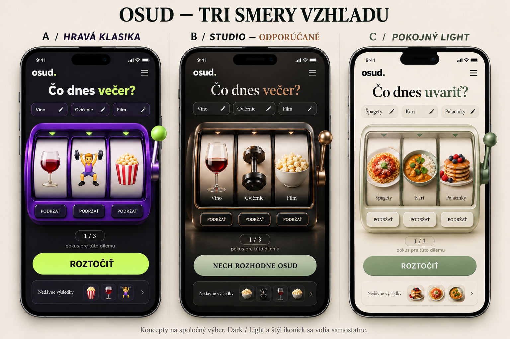

# Osud — návrh druhej fázy

Stav: návrhy na spoločný výber, nie schválený nový vzhľad. Implementované v tejto fáze je iba hamburger menu a režimy Dark/Light. Hravé emoji zostávajú zachované. Grafické koncepty sú ilustrácie, nie snímky fungujúcej druhej verzie.

## Čo som skutočne prezrel

Priame stránky wheelofnames.com, pickerwheel.com, spinthewheel.app a stránku Decision Roulette v App Store sieťový proxy tohto prostredia odmietol chybou CONNECT 403. Ich aktuálne rozhranie ani funkcie preto neoznačujem za overené. Namiesto toho som prečítal dostupné verejné projekty na GitHube a prezrel dostupnú snímku prvého z nich:

| Zdroj | Overený obsah | Čo by sme mohli využiť |
| --- | --- | --- |
| [Wheel of Names — mihailgaberov](https://github.com/mihailgaberov/Wheel-of-Names) | README popisuje samostatnú otázku, zadávanie položiek cez Enter, upravovaný zoznam a animáciu s postupným spomalením. Prezretá aj snímka `screenshots/initial-screen.png`. | Krátka vlastná otázka nad mašinou; rýchle pridanie možnosti klávesom Enter. Veľký úvodný nadpis zmenšiť. |
| [Wheel of Names — kilee1230](https://github.com/kilee1230/wheel-of-names) | README popisuje pridávanie, miešanie a mazanie položiek, zvuky a výrazné oznámenie výhercu v dialógu. | Výsledok musí byť jasný a hneď ponúknuť ďalšiu otázku. Automatické vyraďovanie výsledku sa pre náš limit troch pokusov nehodí. |
| [Spin To Win — Mark1626](https://github.com/Mark1626/spin-to-win) | README popisuje jednoduchý náhodný výber, PWA a zachovanie položiek v localStorage po obnovení stránky. | Zachovať jednoduchosť a už existujúce lokálne ukladanie; prípadné pridanie na plochu riešiť ako ďalšiu samostatnú funkciu. |
| [Roulette — dlvhdr](https://github.com/dlvhdr/roulette) | README ukazuje rozhodovanie s vlastným názvom otázky, napríklad „What's for dinner?“, a krátkym zoznamom možností. Je to terminálový projekt, nie vzor webového grafického rozhrania. | Otázka má byť osobná a konkrétna: „Čo dnes uvariť?“ namiesto stále rovnakého nadpisu. |

Tieto zdroje slúžia ako inšpirácia pre ovládanie. Kód, grafika ani screenshoty nie sú prevzaté do aplikácie.

## Tri smery

### A — Hravá klasika

Zachovať fialovú mašinu, zelený akcent a súčasné emoji. Zmenšiť marketingový úvod, zvýšiť čitateľnosť názvov a tlačidiel Podržať a presunúť mašinu vyššie na mobile. Najmenšia zmena oproti otestovanej prvej fáze.

### B — Studio (odporúčanie)

Grafitová mašina, jemný kovový/medený detail, decentné svetlo a realistické objekty: sklenený pohár s vínom, kovová činka namiesto emoji postavičky, skutočná miska popcornu alebo jedla. Rovnaké nasvietenie a mierka všetkých symbolov. Rozhranie zostane hravé, ale dospelejšie. Má mať aj svetlú farebnú verziu — realistické ikonky neviažeme iba na Dark.

### C — Pokojný Light

Teplá slonovinová, šalviová zelená, minimum ozdôb a veľké čitateľné ovládanie. Realistické jedlá a predmety. Najpokojnejší vzhľad na každodenné používanie. Režim Dark môže používať rovnaké rozloženie a obrázky.

**Farby a ikonky budú dva samostatné výbery:** Dark/Light a Hravé/Realistické. Používateľ si ich môže skombinovať. Alternatívne balíky ikoniek sa v tomto návrhu ešte neimplementujú.

## Rozloženie ďalšej verzie

1. Hore logo, krátka editovateľná otázka a hamburger menu.
2. Možnosti ako jednoduché editovateľné kartičky. Rýchle pridávanie aj cez Enter.
3. Mašina viditeľná výrazne skôr na mobile; hlavný obsah nemusí začínať veľkým reklamným nadpisom.
4. Tri valce, jasne svietiace podržanie a čitateľné počítadlo pokusov.
5. Po verdikte rovno dostupná Nová dilema, vlastné možnosti a iné predvoľby.
6. História zostáva nižšie. Prípadné obľúbené vlastné dilemy si najprv odsúhlasíme.

**Herné pravidlo sa nemení: najviac tri pokusy na jednu dilemu, nie tri pokusy za deň.** Realistický vzhľad nesmie skrývať úmyselné doplnenie trojice v treťom pokuse.

## Ako realistické ikonky zaviesť rozumne

- Prvá sada približne 12–16 objektov pre najpoužívanejšie témy: víno, činka, popcorn, pizza, sushi, špagety, kari, palacinky, káva, kniha, bicykel a príroda.
- Lokálne optimalizované obrázky v jednotnom štýle. Žiadne vyhľadávanie obrázkov alebo platené AI volanie pri každom napísanom slove.
- Existujúci slovník vyberie význam; používateľský štýl určí, či zobrazíme emoji alebo realistický obrázok. Doterajšie možnosti a história sa nemusia mazať.
- Pre nerozpoznané slovo jeden neutrálny symbol v zvolenom štýle; možnosť ručného výberu zostane.
- Hravý balík ponechať ako alternatívu. Nemiešať náhodné fotografie, emoji a kliparty na jednom valci.
- Mäkké mechanické zvuky a zastavenie valcov v štýle fyzickej mašiny. Stíšenie a obmedzený pohyb zachovať.

## Odporúčané poradie

1. Vybrať A/B/C alebo ich kombináciu a realistický štýl symbolov.
2. Pripraviť jednu ucelenú sadu realistických objektov a kompaktnejší mobilný prototyp.
3. Porovnať ho so súčasnou verziou, potom implementovať prepínač ikoniek.

Návrh: **B ako nový vizuálny smer, Dark/Light nezávisle a A ako zachovaný voliteľný balík ikoniek.**
